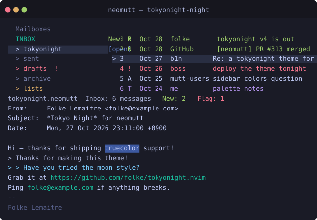
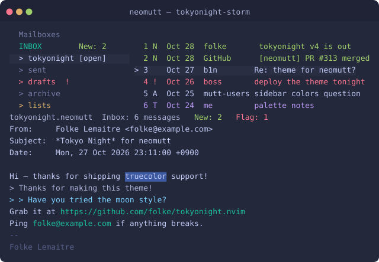
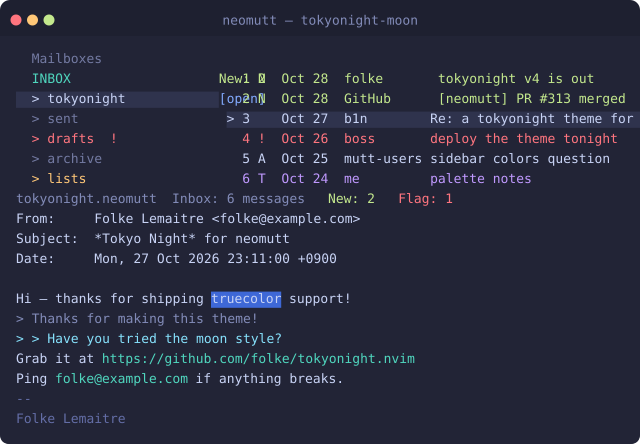
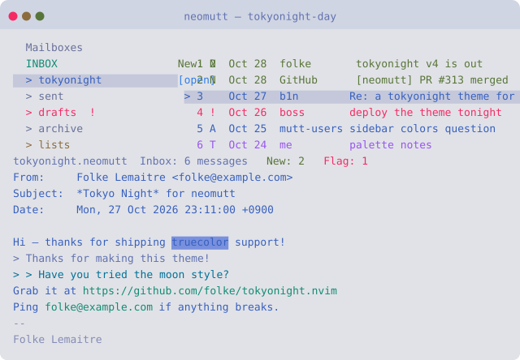

# tokyonight.neomutt

[](LICENSE)
[](https://neomutt.org/)
[](#variants)

**English** | [简体中文](README.zh-CN.md)

**[Tokyo Night](https://github.com/folke/tokyonight.nvim) themes for [NeoMutt](https://neomutt.org/).**

Four color schemes — `night`, `storm`, `moon` and `day` — ported from folke's tokyonight.nvim, covering **every color object NeoMutt documents**: index, pager, sidebar, compose, quoted text, body markup and status-bar counters.

<p align="center">
  
</p>

| storm | moon | day |
| :---: | :---: | :---: |
|  |  |  |

## Features

- **Complete coverage** — all 55 colorable objects, verified against NeoMutt's object registry (`ColorFields` in `color/commands.c`) and tested against a real binary: `sidebar_*` (9), `compose_*` (5), quoted levels 0–9, per-column index colors, `attach_headers`, `warning`/`message`/`prompt`/`options`, `italic`, help-page stripes (`stripe_even`/`stripe_odd` — not even in the manual's tables yet), and status-bar counter highlighting (`New: 2`, `Flag: 1`, …).
- **Two color-depth variants** — a 256-color theme that works in *any* terminal, and a truecolor theme with the exact palette.
- **Drop-in structure** — same object set (and more) as the popular catppuccin/neomutt theme, so switching is a one-line change.
- **Deterministic** — all files are generated from a single palette definition (`scripts/generate_themes.py`), so variants never drift apart.

## Requirements

| Variant | Needs |
| :-- | :-- |
| `themes/*.neomuttrc` (256-color) | any NeoMutt, any terminal |
| `themes/truecolor/*.neomuttrc` | NeoMutt ≥ 2021-02-05, a truecolor terminal, **and** a TERM whose terminfo advertises 16M colors |

### The truecolor catch (read this)

NeoMutt accepts `#RRGGBB` colors only when **both** are true:

1. `set color_directcolor = yes` (the truecolor theme file does this for you), **and**
2. `COLORS` (from your terminal's terminfo entry) is 16 777 216 — i.e. `TERM` is something like `xterm-direct`, `xterm-256color` will **not** do.

If a condition is missing you'll see one of these errors on startup:

```text
Direct colors support disabled: color normal #c0caf5 default   ← (1) missing
color normal #c0caf5 default: color not supported by term      ← (2) missing
```

Note that `$COLORTERM=truecolor` is **not** consulted by NeoMutt. If you can't change `TERM` (ssh, tmux, …), just use the 256-color variant — it is a carefully matched approximation and looks right.

## Install

### Option 1 — installer

```zsh
git clone git@github.com:b1nhack/tokyonight.neomutt.git
cd tokyonight.neomutt
./install.sh night               # night | storm | moon | day
./install.sh --truecolor night   # exact-palette variant
```

All four variants are copied to `~/.config/neomutt/` (truecolor ones into a `truecolor/` subdirectory), so switching later needs no re-install. The installer prints the exact `source` line for the variant you chose.

### Option 2 — manual

```zsh
mkdir -p ~/.config/neomutt
cp themes/tokyonight-night.neomuttrc ~/.config/neomutt/
```

Then add to your `neomuttrc`:

```muttrc
source ~/.config/neomutt/tokyonight-night.neomuttrc
```

### Switching variants

Source a different file — the last one sourced wins:

```muttrc
source ~/.config/neomutt/tokyonight-night.neomuttrc
# source ~/.config/neomutt/tokyonight-storm.neomuttrc
```

## Variants

| Theme | Background | Feels like |
| :-- | :-- | :-- |
| `tokyonight-night` | `#1a1b26` | The default: clean, dark, blue-tinted |
| `tokyonight-storm` | `#24283b` | Softer, stormier blue-grey |
| `tokyonight-moon` | `#222436` | More saturated, "moonhaze" accents |
| `tokyonight-day` | `#e1e2e7` | The light variant for bright terminals |

## Color mapping

Tokyonight.nvim palette token per NeoMutt object (night values; the other variants substitute the matching token):

| NeoMutt object | token | night |
| :-- | :-- | --: |
| `normal` | foreground | `#c0caf5` |
| `error` | red | `#f7768e` |
| `warning` | yellow | `#e0af68` |
| `message` | green | `#9ece6a` |
| `options`, `attachment` | magenta | `#bb9af7` |
| `prompt`, `compose_header` | blue + bold | `#7aa2f7` |
| `progress` | blue on `bg_highlight` | `#7aa2f7` / `#292e42` |
| `status` | `fg_dark`; counters: `New:` green, `Del:`/`Flag:` red, `Post:` yellow | `#a9b1d6` |
| `indicator` | foreground on `bg_highlight` | `#c0caf5` / `#292e42` |
| `tree`, `index_tree` | `fg_dark` | `#a9b1d6` |
| `tilde`, `signature` | comment | `#565f89` |
| `markers` | orange | `#ff9e64` |
| `hdrdefault` | `fg_dark` | `#a9b1d6` |
| `header` | blue (labels read as titles) | `#7aa2f7` |
| `attach_headers` | `dark5` | `#737aa2` |
| `search` | foreground on `bg_search` | — / `#3d59a1` |
| `bold`, `underline`, `italic` | foreground + attribute | `#c0caf5` |
| `stripe_even` / `stripe_odd` (help page) | transparent / `bg_dark` | — / `#16161e` |
| `index ~N` (new) | green | `#9ece6a` |
| `index ~F` (flagged), `~D` (delete) | red | `#f7768e` |
| `index ~T` (tagged) | magenta | `#bb9af7` |
| `index_number`, `index_size` | `dark3` | `#545c7e` |
| `index_date` | comment | `#565f89` |
| `index_flags` | orange | `#ff9e64` |
| `index_collapsed` | yellow | `#e0af68` |
| `index_label` | magenta | `#bb9af7` |
| `index_tags`, `index_tag` | `green1` | `#73daca` |
| `index_author` | blue, only on lines *without* a flag color | `#7aa2f7` |
| `index_subject` | foreground, only on lines *without* a flag color | `#c0caf5` |
| `sidebar_background` | `fg_dark` on `bg_dark` | `#a9b1d6` / `#16161e` |
| `sidebar_divider` | `bg_highlight` | `#292e42` |
| `sidebar_highlight` | foreground on `bg_highlight` | `#c0caf5` / `#292e42` |
| `sidebar_indicator` | blue | `#7aa2f7` |
| `sidebar_new` / `sidebar_unread` / `sidebar_flagged` | green / yellow / red | `#9ece6a` / `#e0af68` / `#f7768e` |
| `sidebar_ordinary` | `dark5` | `#737aa2` |
| `sidebar_spool_file` | teal | `#1abc9c` |
| `compose_security_none` / `_sign` / `_encrypt` / `_both` | `dark5` / cyan / blue / `green1` | — |
| `quoted` | `fg_dark`; then cyan, `blue5`, comment, `dark5`, `dark3`… | `#a9b1d6` |
| `body` — e-mail & URLs | teal (NeoMutt's link color) | `#1abc9c` |
| `body` — `*bold*` / `_underlined_` / `/italic/` | `blue5` + matching attribute | `#89ddff` |

Deliberate choices, documented so you can change them:

- **`index_author` / `index_subject` use the complement pattern `!(~N|~F|~T|~D)`** — per-column colors overlay whole-line colors, so coloring those columns unconditionally would mute the whole-line flag colors. The complement pattern tints them only on lines that have no flag color, so you get column styling *and* the classic "new mail is green" look at the same time.
- Backgrounds are `default` (transparent) almost everywhere, so the theme adapts to your terminal's background; only `indicator`, `search`, `progress`, the stripes and the sidebar paint their own.

## Customization

The theme files are plain muttrc — edit and re-source. Handy additions:

```muttrc
# flag the author column of unread mail
color index_author magenta default "~N"

# colorize the whole status bar
color status default #292e42
```

Reset a list back to defaults with `uncolor`:

```muttrc
uncolor index "~N"      # drop the green new-mail lines
uncolor body *          # drop all body regexes
```

## Regenerating themes and previews

```zsh
python3 scripts/generate_themes.py    # renders themes/ from the palettes
python3 scripts/generate_previews.py  # renders assets/ from themes/truecolor/
```

## Credits & license

- Palettes: [folke/tokyonight.nvim](https://github.com/folke/tokyonight.nvim) — Apache License 2.0, used with attribution (see [LICENSE](LICENSE)).
- Theme structure inspired by [catppuccin/neomutt](https://github.com/catppuccin/neomutt), extended to full object coverage.
- This repository: MIT.

---

[中文说明（README.zh-CN.md）](README.zh-CN.md)
